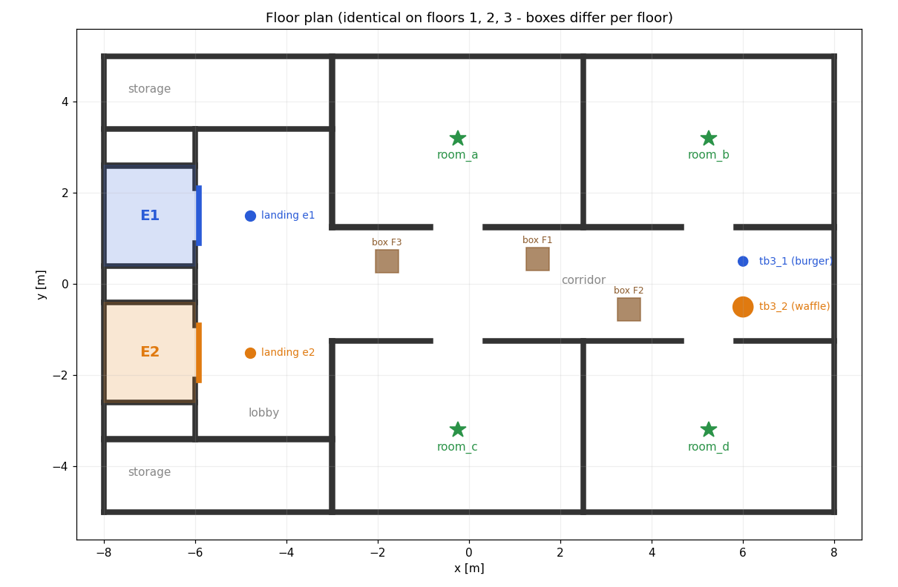

# Dual TurtleBot3 Elevator Simulation (ROS 2 Jazzy · Gazebo Harmonic · Nav2)

Two TurtleBot3 robots, a **Burger** (`tb3_1`) and a **Waffle** (`tb3_2`), each use **their own elevator**
in a 3-floor building. A mission takes a robot through these steps:

1. drive from its home on the ground floor to its elevator,
2. **call** the elevator,
3. board, ride to the requested floor and exit,
4. drive to a named room,
5. come back, call the elevator again, ride down to the ground floor and drive home.

The elevators are physical in Gazebo. The cabin rises on a prismatic joint and the landing doors
slide open and closed, so the robots really drive into and out of the cabin.



## Building

| Item | Value |
|---|---|
| Floors | 1 (ground, z = 0 m), 2 (z = 3 m), 3 (z = 6 m). Same wall layout on every floor, so one 2D map serves all floors |
| Footprint | 16 m × 10 m |
| Elevators | **E1** serves `tb3_1`, **E2** serves `tb3_2`. 2 m × 2 m shafts on the west side, cabin speed 0.4 m/s, 1.2 m sliding doors on every landing |
| Rooms | `room_a`, `room_b` (north), `room_c`, `room_d` (south), on every floor |
| Robots' home | `tb3_1` (6.0, 0.5), `tb3_2` (6.0, −0.5), floor 1, facing west |
| Unmapped obstacles | One box per floor in the corridor, in a different place on each floor. They are **not** in the map, so Nav2 has to detect them with the LiDAR and go around |

Everything is generated from **`src/elevator_sim/config/building.yaml`**:
`ros2 run elevator_sim generate_building --config <yaml> --out src/elevator_sim`
regenerates `worlds/building.sdf` and `maps/building.{pgm,yaml}`.

## Quick start

Requirements: Docker. The host can be any Linux, including Ubuntu 22.04; Jazzy runs inside the container.

```bash
cd ~/elevator_ws
./run.sh image        # build the Docker image (once, ~5 GB)
./run.sh build        # colcon build
./run.sh sim          # terminal 1: Gazebo + RViz + both robots + elevators + Nav2
```

Wait until RViz shows both robots localized (about 30 s). Then, in a second terminal:

```bash
# one robot
./run.sh mission --robot tb3_1 --floor 3 --goal room_b

# both robots, at the same time
./run.sh missions mode:=parallel   tb3_1_floor:=3 tb3_1_goal:=room_b tb3_2_floor:=2 tb3_2_goal:=room_c

# both robots, one after the other (tb3_2 starts after tb3_1 has finished)
./run.sh missions mode:=sequential tb3_1_floor:=2 tb3_1_goal:=room_a tb3_2_floor:=3 tb3_2_goal:=room_d
```

`--floor 1` gives a same-floor mission: room and back, with no elevator.

Options for `./run.sh sim`: `gui:=false` (no Gazebo window), `rviz:=false`, `nav_delay:=12.0`.

## Mission sequence

```
NAV landing(F1) → CALL(F1) → BOARD → RIDE(F→T) → EXIT → CLOSE → NAV room(T)
→ NAV landing(T) → CALL(T) → BOARD → RIDE(T→F1) → EXIT → CLOSE → NAV home(F1)
```

* **NAV**: Nav2 `NavigateToPose`, using AMCL on the shared map, a NavFn planner and the Regulated Pure Pursuit controller.
* **CALL / RIDE**: `GotoFloor` action on the robot's own elevator. The elevator closes its doors (with a safety check),
  travels, and opens the doors at the target floor.
* **BOARD / EXIT**: the robot turns toward the cabin centre (or the landing spot), clears its local costmap, and drives
  straight with Nav2 `DriveOnHeading`. This only starts once the elevator reports `DOORS_OPEN` at the robot's floor. Afterwards the
  localized pose is checked to confirm the robot is inside the cabin (or out of it).
* **CLOSE**: the robot tells the elevator it has finished boarding or exiting, and the doors close.
* **Cabin re-localization**: AMCL is unreliable inside the small, nearly symmetric cabin, and it doesn't update while
  the robot stands still during the ride. So after boarding, after turning around and before exiting, the robot fits
  its LiDAR scan to the cabin's three known walls (point-to-line ICP, `cabin_localizer.py`). It then resets AMCL to
  that pose and re-centres in the cabin if it is off by more than 10 cm. In simulation this corrected AMCL errors of
  up to 30 cm, which had previously steered the robot into the door frame.

## ROS 2 interfaces (`elevator_interfaces`)

| Name | Type | Purpose |
|---|---|---|
| `/e1/goto_floor`, `/e2/goto_floor` | action `GotoFloor` | call or ride to a floor; feedback gives phase, height and door opening |
| `/e1/command`, `/e2/command` | service `ElevatorCommand` | `CLOSE_DOORS`, `OPEN_DOORS`, `BLOCK_DOOR`/`CLEAR_DOOR` (fault injection), `EMERGENCY`, `RESET` |
| `/e1/state`, `/e2/state` | msg `ElevatorState` | state, floor, height, door opening, doorway blocked, owner, fault (10 Hz) |
| `/elevator_markers` | `MarkerArray` | elevator status shown in RViz |

Elevator state machine:
`IDLE → DOORS_OPENING → DOORS_OPEN → DOORS_CLOSING → MOVING → DOORS_OPENING …`, plus `FAULT` and `EMERGENCY`.
The cabin never moves while any of its doors is open (interlock).

## Failure handling

| Situation | Behaviour |
|---|---|
| Nav2 goal fails | Up to 3 attempts, clearing the costmaps between attempts |
| Elevator request rejected or aborted | Up to 2 retries. If the elevator is in `FAULT` or `EMERGENCY`, the mission aborts straight away |
| Someone or something in the doorway while the doors close | Doors reopen, up to 3 times, then `FAULT` (the goal aborts and the cabin does not move) |
| Door or cabin doesn't reach its position in time | `FAULT` |
| DriveOnHeading refuses to move near the door frame (its inflated-costmap check is conservative) | Falls back to a slow LiDAR-guarded creep: it steers to the target and stops if anything is closer than robot radius + 8 cm ahead |
| Robot not inside the cabin after boarding, or not out after exiting | One corrective attempt, then the mission fails |
| Elevator state topic still shows the old state just after the action result | The boarding/exit guard re-checks for up to 5 s before failing |
| Elevator not at the robot's floor with doors open when boarding or exiting | The step fails; the robot never drives into a closed shaft |
| Any unrecoverable failure | Safe stop: Nav2 task cancelled, zero velocity, failure recorded in the metrics |

Fault-injection examples (while a mission is running):

```bash
./run.sh elevator e1 block       # simulated obstruction in E1's doorway
./run.sh elevator e1 clear
./run.sh elevator e2 emergency   # stop E2 immediately
./run.sh elevator e2 reset
```

## Metrics

Each mission appends one row to **`metrics/missions.csv`** with these columns:
timestamp, mode, robot, elevator, target floor, goal, success, failed step, message,
total sim and wall time, sim time per category (`nav`, `wait_elevator`, `board_exit`, `ride`),
navigation and elevator retries, and steps done out of total.

## Tests

```bash
./run.sh test
```

Unit tests, which need no simulator:
* `test_elevator_fsm.py`: elevator state machine (rides, interlock, obstruction → reopen → fault, timeouts, emergency/reset, profile limits)
* `test_building.py`: the map, world and config agree (key points free, shaft holes, door clearance, plan structure)
* `test_mission_core.py`: mission executor against a fake robot and elevator (full round trip, retries, faults, safe stop, stale state, CSV)
* `test_cabin_localizer.py`: cabin ICP on synthetic noisy scans; recovers 30 cm and 12° errors to within 3 cm and 1.5°

## Package layout

```
elevator_ws/
├── run.sh                       Docker helper
├── docker/Dockerfile            ROS 2 Jazzy + Gazebo Harmonic + Nav2 + TurtleBot3
├── metrics/                     mission CSV (created at runtime)
└── src/
    ├── elevator_interfaces/     GotoFloor.action, ElevatorCommand.srv, ElevatorState.msg
    └── elevator_sim/
        ├── config/              building.yaml, nav2_params.template.yaml
        ├── launch/              sim.launch.py, missions.launch.py
        ├── worlds/, maps/       generated from building.yaml
        ├── rviz/                elevators.rviz
        ├── elevator_sim/        building, building_gen, elevator_fsm, elevator_controller,
        │                        cabin_localizer, mission_core, mission, metrics, elevator_cli
        └── test/
```

## Known limitations

* **Simulation speed.** On a CPU-only machine (4 cores, no GPU driver) Gazebo, two Nav2 stacks and RViz run below
  real time. Missions use simulation time for their timeouts, so slower runs still behave correctly; they just take
  longer on the wall clock.
* **Doorway sensor.** The elevator's doorway "light curtain" uses Gazebo's true robot positions, standing in for a
  real door sensor.
* **One map for all floors.** Localization uses one 2D map because the floors share a layout. Which floor a robot is
  on is tracked by the mission and the elevator, not by the map.
* **Waffle camera.** The Waffle's camera is reduced to 320×240 at 5 Hz to save CPU. Nothing uses it.
